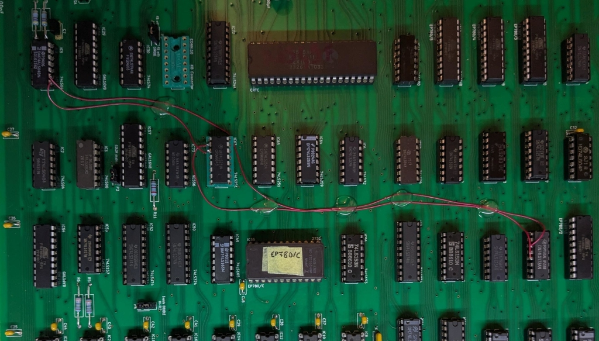

# Differences with Apple IIe

This document collects notes on the functional differences I spot while analyzing the DELTA computer.

It could contain inaccurate or misunderstood information, and I will integrate it when I find additional information (or fix mistakes).

## ROM

### CRTC Initialization 

The EP780/B ROM (27C64) contains a modified reset vector routine that does a `STA $C007`, jumps to `$C0A0` to initialize the CRTC registers, then jumps back to the reset routine and does a `STA $C006` before continuing normally with the rest of the initialization.

Softswitch `$C007` normally enables the internal ROM for addresses `$C100 - $CFFF` in an Apple IIe, and `$C006` enables the slot ROM for the same range.

`$C0A0` falls outside of said range (and actually in the I/O page range `$C000 - $C0FF`, but the DELTA is using it to store the CRTC init routine, ranging from `$C0A0` to `$C0CA`, and is seemingly accessible once the internal ROM is selected.

### Self-Test

The CD ROM in an Apple IIe contains the self-testing routines (entered by pressing "OPEN Apple" + "CLOSED Apple" upon reset) at `$C401`. 
You can find a disassembly of the relevant code [here](https://github.com/GLGPrograms/appleIIe-self-test/blob/main/self-test.asm).

The routines present in the DELTA ROM (EP780A) are modified, in some cases by changing instructions, but mostly by NOP'ing out areas: `$C430` through `$C44C` (apart from some `INX` used to skip to the next test, this is MMU test zone) , `$C5CE` through `$C5EA` (part of the RAM test from here onward),  `$C622` through `$C644`, `$C676` through `$C696`.

## Graphics

### Wizardry

The game `Wizardry: Proving grounds of the Mad Overlord` shows a corrupted intro screen when jumper P4 is closed, enabling DHR mode.

**TODO:** Investigate the decoding that enables DHR mode, and find differences (if any) with an original IIe. A starting point could be IC58.

## Memory

### $C011 and $C012 IO

`$C011` address should contain the state of the selected $Dxxx bank on bit 7 of the response, while `$C012` should contain information on the switch of the same address range between ROM and RAM.

In the DELTA, the responses for reads on addresses between `$C010 - $C017` are handled by IC63, a 74LS251. I1 of said IC is tied to VCC, I2 to GND, hardwiring the values for the two addresses.

#### Potential fix

1. Remove IC63 (74LS251) from its socket and bend pin 2 and 3 outward so they don't make contact with the socket anymore
2. Solder a jumper wire from pin 8 of IC5 (74LS04) to pin 3 of IC63
3. Solder a jumper wire from pin 9 of IC5 to pin 5 of IC41 (74LS173)
4. Solder a jumper wire from pin 3 of IC41 to pin 2 of IC63

### $Dxxx bank switching

The "Language card" style bank switching is handled by IC41 (74LS173) and IC42 (PLD). According to Jim Sather's Understanding the Apple IIe, enabling writes to the RAM bank in `$Dxxx` should work by having the `/HRAMWRT` signal reset, which first requires having the `PRE-WRITE` signal to be set.

`/HRAMWRT` is reset by an odd **read** access in the `$C08x` range while `PRE-WRITE` is set. It can be set by **any even access** in the `$C08x` range. Any other type of access leaves the state of `/HRAMWRT` unchanged.

In the DELTA, IC41 and IC42 set the write enable signal only by checking that the access to the address is an odd one, and that the pre-write signal is enabled. They do not differentiate between reads or writes. So **odd** writes seems to be able to reset the signal equivalent to `/HRAMWRT` when the pre-write is set already.

