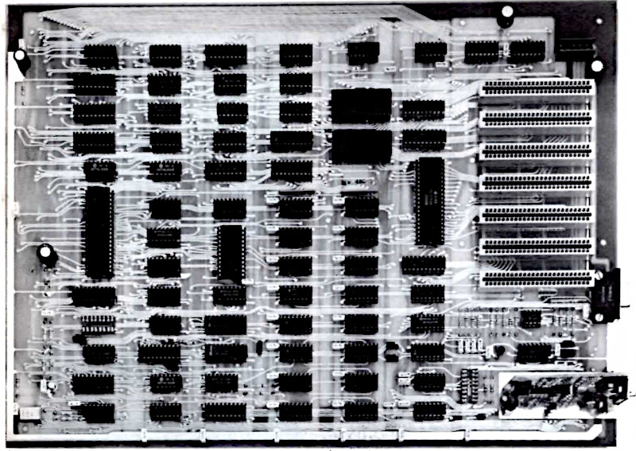
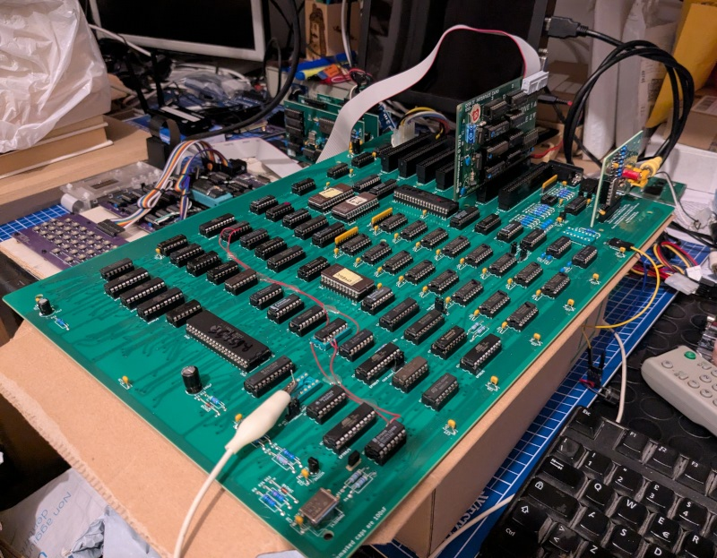

# Nuova Elettronica DELTA computer - Redux

## DISCLAIMER

Any use of this project is **under your own responsibility**.
By using this project You will agree that I cannot be held responsible if it will destroy any of your devices, damage your computer, burn down your house or whatever.

### Sponsorship

This project is sponsored by [PCBWay](https://pcbway.com).
PCBWay specializes in manufacturing high-quality PCBs and makes them affordable to hobbyist and professionals alike.

The range of services they offer include PCB prototyping, assembly, instant quotes for your order, a verification process by a team
of experts and an easy to use, hassle-free order process.

I'm grateful to PCBWay for their support in developing this board. It was invaluable, and, thanks to them and thanks to the people that supported me, I was able to push this forward and create the first revision of the DELTA Redux!

## Introduction

This repository contains a recreation of the schematics and PCBs for the DELTA computer, an Apple IIe clone by Nuova Elettronica.

The schematics have been reconstructed starting from the originals found in the Nuova Elettronica magazine (scans included in the repository)
and have been corrected comparing them to scans of the original PCBs, while a new PCB was redrawn.

The files in the `PLDs_ROMs` directory have been provided by Roberto Bazzano, that also uploaded all the available documentation about the DELTA [on his website](https://www.z80ne.com/delta).
His page includes the original schematic scanned from the magazine, the EPROM/PLD dumps, gerbers for two of the boards plus high resolution scans of the PCBs.

This project aims at the following:
1. Recreate the schematics of the main DELTA boards, so they are searchable and easier to use for troubleshooting
2. Rebuild the PCBs using KiCAD, possibly using footprints for easier to find connectors and transistors, and to allow further modifications of the project should someone wish to do so

**Many thanks to Roberto** because, without him, all the effort in recreating the schematics would have been moot!

### Compatibility

The [original article](Docs/delta_computer.pdf) by Nuova Elettronica touts "perfect compatibility with APPLE 2 and APPLE 2E", but I've found out that this is not really the case.

You can reference [this file](Apple2e_differences.md) for differences (and fixes) I found when comparing to an Apple IIe.

Also, note that this clone, by default, boots in 50Hz mode. 60Hz mode can be obtained by properly setting up the CRTC. I have prepared a modified EP780/A ROM for this, you can find it [here](PLDs_ROMs/DELTA_Mainboard/mod/EP780A_60hz.BIN).

Getting the //e enhanced ROMs to work was also easy enough, as it was sufficient to add the CRTC initialization code and the call to it. Note that the VIDEO ROM was not ported over, as the organization of that
ROM on the delta is totally different. Given that I actually plan to evolve this computer using an A2DVI as video circuitry, this should be a non-issue.

### Support

If you wish to support me in building new hardware and software for old machines, [throw a few euros in my direction via Ko-Fi](https://ko-fi.com/hkzlab) ☕!

## Build one!

### Order the PCBs

You can find the gerbers in this repository, or you can order the PCBs at **PCBWay!**

Note that you will need, at least, the motherboard (LX780) and one of the video modules. The keyboard is currently work in progress.

- [LX780](https://www.pcbway.com/project/shareproject/DELTA_Redux_Apple_IIe_clone_dc32412e.html), the motherboard
- [LX782](https://www.pcbway.com/project/shareproject/DELTA_Redux_Composite_TV_Video_card_8b8ff858.html), monochrome composite/VHF video output
- [LX783](https://www.pcbway.com/project/shareproject/DELTA_Redux_RGB_Video_card_4a65742e.html), analog RGB video output

### Fixes

Every board directory contains a `fixes.md` file detailing the fix to apply to each revision of the boards:

- [LX780](LX780_Delta-original/fixes.md)
- [LX782](LX782_Monochrome_Video/fixes.md)
- LX783

### Bill of Material

Every board directory contains a `bom.md` file containing the bill of material for the card.

- [LX780](LX780_Delta-original/bom.md)
- [LX782](LX782_Monochrome_Video/bom.md)
- [LX783](LX783_RGB_Video/bom.md)

## TODO

- Explore the functional differences with an original Apple IIe
- Build a keyboard
- Build a case
- Investigate replacing the video circuitry with an embedded A2DVI board
- Test cassette IN/OUT
- Modify //e enhanced ROMs self test to match behavior of DELTA ROMs

## Thanks

- [Roberto Bazzano](https://www.z80ne.com/) for the photos and PLD dumps
- [DosFox](https://tech.lgbt/@DosFox) for the support
